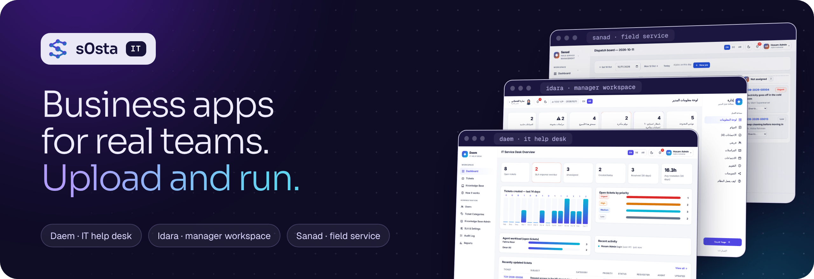
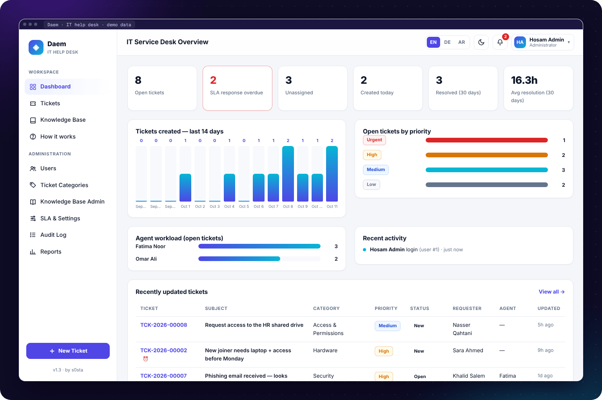
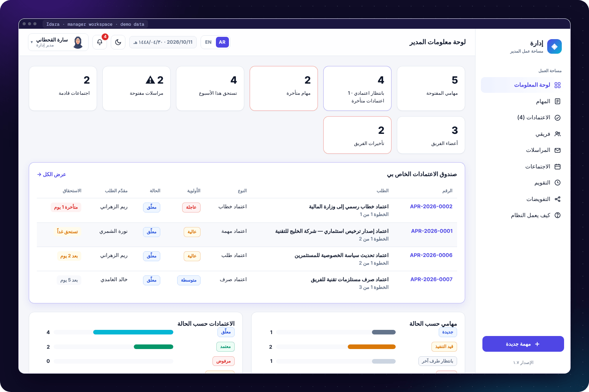
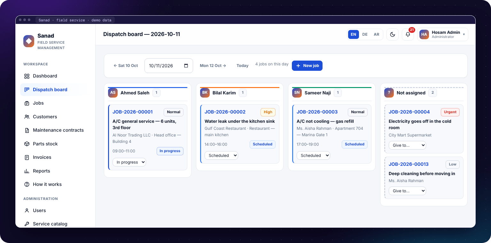

<div align="center">

<a href="https://s0sta.com/#projects"></a>

<br>


### Three ready-to-use web apps for companies.

Upload one folder to normal web hosting, open the installer, and start working.

**[Daem](#daem--it-help-desk)** · **[Idara](#idara--manager-workspace)** · **[Sanad](#sanad--field-service)** · **[Install](#install-in-5-steps)** · **[Try it on your computer](#try-it-on-your-computer)**

</div>

<br>

## The apps

| | App | Made for | Languages |
|:--:|:--|:--|:--|
| 🎫 | **[Daem](daem-helpdesk/)** · IT help desk | IT teams: tickets, SLA timers, knowledge base | English · Deutsch · العربية |
| 🏛️ | **[Idara](idara-manager/)** · Manager workspace | Managers: tasks, approvals, letters, meetings | العربية · English |
| 🛠️ | **[Sanad](sanad-field-service/)** · Field service | Service companies: jobs, technicians, stock, invoices | English · Deutsch · العربية |

---

## Daem · IT help desk

**People report a problem. The IT team fixes it on time.**

- **Tickets** with category and priority, and **SLA timers** for the first answer and the fix, with a warning before a deadline is missed
- **Public replies** for the user and **private notes** for the IT team
- A ticket opens again by itself when the user answers a solved ticket
- **Knowledge base**: helpful articles show up while the user types a new ticket
- **Dashboards and reports**: workload per agent, tickets of the last 14 days, **SLA %** and CSV export
- **Audit log** of every action

Roles: Administrator · Agent · Requester

<p align="center"></p>

[Read more about Daem →](daem-helpdesk/README.md)

---

## Idara · Manager workspace

**إدارة** · **Everything a manager needs every morning: my tasks, my team's tasks, and the approvals waiting for me.**

- **Tasks** with checklists. The progress updates by itself.
- **Approval chains** with several steps: approve, return for changes or reject, always with a note
- **Delegation**: someone else can approve for you while you are away
- **Letters** register (in and out), **meetings** with attendance and minutes, and a **calendar**
- **Team view**: open and late work for every team member
- **Reports** with CSV export and a full **audit log**

Roles: System Administrator · Executive · Department Manager · Employee. Each person only sees the work they are allowed to see.

Arabic is the main language (right to left), with a full English version.

<p align="center"></p>

[Read more about Idara →](idara-manager/README.md)

---

## Sanad · Field service

**سند** · **For companies that send technicians to customers: A/C, plumbing, electrical, cleaning, pest control.**

- **Dispatch board**: one column per technician, plus a "Not assigned" column
- **Jobs** with status, priority, time window, checklist, notes and photos
- **Parts stock**: used parts are removed from stock by themselves, with low-stock alerts
- **Maintenance contracts (AMC)**: planned visits become jobs in one click
- **VAT invoices** from a finished job (work and parts), payments, and a print-ready A4 page
- **Reports** with CSV export, notifications and a full **audit log**

Roles: Administrator · Dispatcher · Technician (sees only their own jobs) · Accountant

<p align="center"></p>

[Read more about Sanad →](sanad-field-service/README.md)

---

## What all three apps have

- 🧩 **No frameworks:** plain PHP 8 and PDO, with plain JavaScript and CSS. No Composer, no Node, no build step.
- 🪄 **Easy install:** a web installer. Choose **SQLite** for a quick demo or **MySQL / MariaDB** for real use.
- 🔒 **Secure by default:** prepared SQL, hashed passwords, CSRF tokens on every form, login limits, safe sessions and checked uploads.
- 🧾 **Audit log:** every action is saved: who, what, when, and from which IP.
- 🩺 **Self-check:** `diag.php?go=1` checks the server, and `integrity.php` checks that all files are complete.
- 🌍 **Languages:** right-to-left layout for Arabic, and a simple "How it works" guide inside each app.

## Install in 5 steps

1. **Download** this repository (green **Code** button → **Download ZIP**) and unzip it.
2. **Upload** one app folder, for example `daem-helpdesk/`, to your hosting (for example `public_html/helpdesk/`).
3. **Open** `install.php` in your browser, for example `https://your-site.com/helpdesk/install.php`.
4. **Choose** SQLite or MySQL, type your details and create the first admin account.
5. **Delete** `install.php` (and `diag.php`) from the server. Done. Sign in and start.

Every app has a full step-by-step guide for Hostinger: `UPLOAD-INSTRUCTIONS.txt`.

## Try it on your computer

You only need PHP 8.1 or newer with SQLite.

```bash
cd daem-helpdesk              # or idara-manager, or sanad-field-service
php -S localhost:8000         # then open http://localhost:8000/install.php and choose SQLite
php seed.php                  # optional: adds demo data and prints the demo sign-ins
```

## Tested

Each app has end-to-end tests (a real install, sign-in and every main flow) and language tests (every text exists in every language).

| App | End-to-end checks | Language checks |
|:--|--:|--:|
| Daem | 58 | 43 |
| Idara | 175 | 22 |
| Sanad | 89 | 42 |

Run them with `bash tests/smoke.sh` and `bash tests/i18n-smoke.sh` while the app runs on its local test port (see the top of each test file).

<br>

<div align="center">

Made by **[Hosam Hani (s0sta)](https://github.com/s0sta)** · [s0sta.com](https://s0sta.com) · [LinkedIn](https://www.linkedin.com/in/hosam-hani-abdelati/) · [X](https://x.com/s0sta_)

© 2026 s0sta. All rights reserved.

</div>
